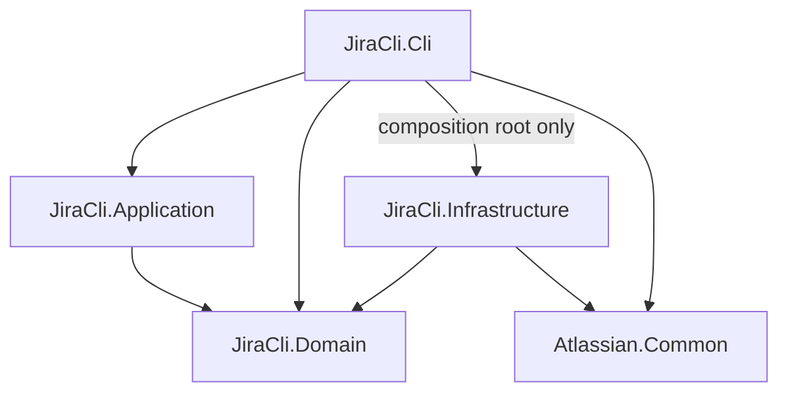
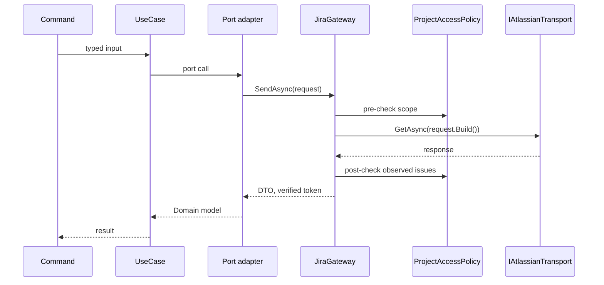
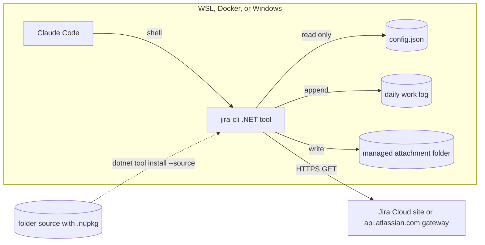

# Architecture Spine — jira-cli

## Design Paradigm

Hexagonal. `Domain` is the center and holds the logic and the ports. Everything that touches the outside world is an adapter. `Application` stays very thin: one use case per Command, orchestration only.

| Layer | Project | Holds |
| --- | --- | --- |
| Driving adapter | `JiraCli.Cli` | Commands, `Program` wrapper, composition root, config schema, output contract types, `ExceptionMapper` |
| Use cases | `JiraCli.Application` | One thin use case per Command |
| Core | `JiraCli.Domain` | Entities, value objects, policies, `AccessSettings`, ports consumed by `Application` |
| Driven adapter | `JiraCli.Infrastructure` | `JiraGateway`, `IJiraGateway`, `IJiraRequest<T>`, Requests, verified tokens, port implementations, ADF converter, attachment store |
| Shared | `Atlassian.Common` | Transport, `ConnectionSettings`, endpoint selection, config loading, user paths, envelope and writer, error categories and exit codes, redaction, work log format and writer. No Jira concepts |

## Invariants & Rules



### AD-1 — Project split and dependency direction [ADOPTED]

- **Binds:** all, NFR-6
- **Prevents:** logic drifting into adapters, and HTTP or JSON concerns leaking into the core.
- **Rule:** Project references follow the diagram and nothing else. `Domain` and `Atlassian.Common` reference no other project in this solution. Ports live in `Domain`. Business decisions live in `Domain`. Each project exposes one `Add…()` registration method; `Cli` uses `Infrastructure` only through it.

### AD-2 — `Atlassian.Common` stays Jira-free

- **Binds:** NFR-6, Confluence seam
- **Prevents:** shared parts becoming unusable for a Confluence client.
- **Rule:** `Atlassian.Common` contains no Jira type, URL, JQL, or field name. App name, product URL segment, and config schema are parameters supplied by the caller.

### AD-3 — Tool-level threat boundary [ADOPTED]

- **Binds:** FR-12 to FR-17, NFR-4
- **Prevents:** builders over- or under-engineering protection against the agent.
- **Rule:** The guarantees hold for every use of jira-cli through its arguments, config path resolution, and Jira responses: none of these can make it write to Jira or read outside the allowed projects. Out of scope, and stated in the documentation: an agent that reads the credentials and calls Jira by other means, tampering with the process's runtime environment, editing the Windows registry, a process under the same account changing the managed folder while a download runs, and other-project data inside a field the engineer lists in `customFieldPassthrough`. Keeping the agent from changing the config file is the engineer's setup responsibility through the README, which covers the file and every ancestor directory. The tool performs no runtime check that the file is writable. The agent may read the file.

### AD-4 — `JiraGateway` is the single outbound path

- **Binds:** FR-12 to FR-15, NFR-4
- **Prevents:** a new command reaching Jira without the safety checks.
- **Rule:** Every Jira call goes through `JiraGateway`, a protection proxy. `JiraGateway` is the only class in `JiraCli.*` that may depend on `IAtlassianTransport`. `IJiraGateway` and `IJiraRequest<T>` are `internal` to `Infrastructure` and are not ports; port implementations depend on `IJiraGateway`. Only the transport implementation may use `HttpClient`.

### AD-5 — Transport is GET-only by type

- **Binds:** FR-15, NFR-4
- **Prevents:** a write request being expressible at all.
- **Rule:** `IAtlassianTransport` exposes only `GetAsync(RelativeRequest, CancellationToken)`. `RelativeRequest` holds a list of path segments, a list of query name and value pairs, and a `ResponseKind` of `Json` or `Download` that selects the timeout profile and nothing else, with no raw string and no method. `GetAsync` returns a disposable `TransportResponse` exposing the body stream, with non-2xx already raised as `TransportException`. The transport alone percent-encodes them, refuses `.` and `..` segments, and hard-codes GET. Adding a non-GET capability requires changing this AD.

### AD-6 — A Request is pure and declares its scope

- **Binds:** F1 to F5, F9, NFR-6
- **Prevents:** URLs built inline, untestable parsing, and requests with no access declaration.
- **Rule:** Each Jira endpoint is one `…Request` class implementing `IJiraRequest<T>` with `Scope`, `Build()`, and `Parse(Stream)`. Both are pure apart from reading the given stream. `T` is an `Infrastructure` DTO that adapters map to Domain models. Any scope with an after-call check accepts only Requests implementing a required observation interface; issue-returning Requests yield one key and project per returned issue, and `GetProjectRequest` yields its project. Requests are plain objects created with `new`, not resolved from DI. API version and URL fragments appear only in Requests.

### AD-7 — Scope kinds, checked before and after every call

- **Binds:** FR-12, FR-13, NFR-4
- **Prevents:** moved tickets, broken queries, or forged identifiers exposing other projects.
- **Rule:** `RequestScope` is a closed set enforced by `JiraGateway` using the pure `ProjectAccessPolicy` (`Domain`). A failed check raises `ProjectNotAllowedException` and no content leaves the Gateway. Issue-returning Requests must request `project` in `fields`. The post-check fails closed: every returned item must yield exactly one non-null `fields.project.key`, allowed by the policy and matching the prefix of the item's `key`. A count mismatch or missing value is a failed check, as is a Request with such a scope that does not implement observation. `GetProjectRequest` checks its response's project key.

| Scope | Before the call | After the call |
| --- | --- | --- |
| `IssueScope(key)` | Project part of the key is allowed; the key is an exact path segment | Post-check on the single returned issue |
| `ProjectScope(keys)` | Non-empty, every key is allowed | Post-check on every returned item |
| `VerifiedIssueScope(token)` | The token was issued by this Gateway instance (AD-8); its key is an exact path segment | None |
| `AttachmentRefScope(ref)` | The ref was minted by this Gateway (AD-8); its id is an exact path segment | None |
| `ChildKeysScope(token)` | The Request type is exactly `GetChildKeysRequest` and the token was issued by this Gateway | Every item has a non-null project; the allow-list is not applied, since only keys are kept (AD-10); the `jql` value contains the token's canonical key |
| `Unscoped` | The Request type is exactly `GetMyselfRequest` | None |

### AD-8 — Sub-resources require a verified issue

- **Binds:** FR-4, FR-9 to FR-11, FR-13
- **Prevents:** comment, changelog, or attachment endpoints bypassing the post-check, since their responses carry no project.
- **Rule:** `SendIssueAsync` accepts only `IssueScope` and returns `(VerifiedIssue, T)` after the post-check; no other path issues a token. Comment, changelog, and attachment-content Requests accept only a `VerifiedIssue` or an `AttachmentRef`, both `internal` to `Infrastructure`. `GetIssueRequest` exposes attachment metadata to the Gateway, which alone mints each `AttachmentRef` into `VerifiedIssue.Attachments`. The Gateway keeps a per-invocation record of what it issued and refuses anything else by object identity. The canonical key from the response is used from then on. Ports take `IssueKey` and an attachment selector, never a token. `GetIssueRequest` is the only source of attachment metadata and its `Parse` ignores embedded `comment`. Comments come only from `GetCommentsRequest`. Attachment bytes are requested by path from the attachment id with `redirect=false`; the absolute `content` URL in metadata is never followed. The CLI selects by ticket key plus `--name`, or `--id` matched against that ticket's attachments. `IAttachmentReader` lists Domain `AttachmentInfo`, and a Domain `AttachmentSelection` applies the selector and raises a `usage` error listing the candidates for an ambiguous name.

### AD-9 — List queries are typed and never auto-widened

- **Binds:** F1, FR-13. Overrides PRD FR-1's no-filter default by user decision.
- **Prevents:** JQL injection, and a query that silently spans all projects.
- **Rule:** `list` requires `--project` (one or more); any disallowed key refuses the whole request. A missing or disallowed project returns `projectNotAllowed` before any HTTP call, and its `hint` always lists the allowed keys and states whether the option was missing. The parser does not mark the option required, since that would yield `usage`; its help text states that it is required. Raw JQL is never accepted. `TicketQuery` (Domain) carries typed filters and `JqlBuilder` (Infrastructure) is the only JQL producer. It escapes every value and always emits the project restriction as a top-level AND. The only exception is `internal JqlBuilder.ChildrenOf(VerifiedIssue)`, which an architecture test allows only `GetChildKeysRequest` to call. The Gateway refuses a `ProjectScope` with no keys rather than filling them in. With no `--status`, the query adds `statusCategory != Done`, and help and the usage guide say so. Default order is `updated DESC`.

### AD-10 — Other-project data is key-only, and traversal names its origin

- **Binds:** F3, FR-7, FR-13, FR-25
- **Prevents:** embedded data leaking from other projects, children being unreachable, and origins that cannot be guaranteed in the log.
- **Rule:** Only `related` outputs relations; `get` output carries none. `Parse` exposes relation data only as `RawRelation`, which Contracts cannot map. `RelatedIssueProjection` (Domain) reduces anything outside the allow-list to `{ key, relationship, accessible: false }`. `history` shows from and to values only for an allow-list of system fields and for custom fields AD-16 would display, and reduces relation fields to keys. Every other field, including `project`, shows its name and timestamp with the values omitted. The Domain `RelationSet` is built only from `parent`, `subtasks`, `issuelinks`, and child keys. Child keys come from `GetChildKeysRequest` with the verified origin, for every issue type, using the fixed JQL `parent = <canonical key>` and `fields=project`, paged to completion. Its `Parse` reads only `key` and `fields.project.key` into `IssueKey` and `ProjectKey`. Summaries of allowed relations come from a `ProjectScope` search, paged to completion and skipped when no relation is allowed; for children it uses `parent = <canonical key> AND project in (<allowed projects among the children>)`. A child whose key prefix and project disagree, or that the summary search does not return, is output key-only with `accessible: false`. Items are one type extending the ticket summary with `relationship` and `accessible`, with summary fields `null` when inaccessible, and one entry per key per relationship after removing duplicates. Each disallowed project among the children adds an entry to `data.notices` from a fixed template whose only variable part is the project key, telling the agent to ask the engineer to add it to `allowedProjects`; this does not affect `ok` or the exit code. `notices` is present, and `null` when empty, only on `related <origin>`. `related <origin> --key <k>` records `origin` first, applies the policy to `k` before any HTTP call and returns `projectNotAllowed` on failure, fetches `origin`, checks `RelationSet`, returning `notFound` on a miss, and finally fetches `k` through `IssueScope`. Plain `get` is logged as direct access with no origin.

### AD-11 — Config has one location and environment is never trusted for it

- **Binds:** FR-12, FR-14, FR-17, FR-23
- **Prevents:** `HOME=...` or `USERPROFILE=...` or an option redirecting to a config with wider projects.
- **Rule:** The path is fixed. Windows: `<RoamingAppData>\jira-cli\config.json`, from `SHGetKnownFolderPath` with an explicit process token; `Environment.GetFolderPath` is banned for these paths. Linux, WSL, and Docker: `<passwd home>/.config/jira-cli/config.json`, with the home from `getpwuid_r`. All environment variables are ignored for this. If the lookup fails, fail with `config` and never fall back. No option or variable overrides the path. The tool only reads this file. The composition root loads config once per invocation, except `--help` and `--version`, before any HTTP call, through `Load(path, JsonTypeInfo<T>)`. `site` must be a single DNS label and `cloudId` a GUID. The file has connection settings at the top level and tool settings under a `jira-cli` section. The schema object goes only to a mapper producing `ConnectionSettings` (Common) from the former and `AccessSettings` (Domain) from the latter. Load failure is a value: `doctor` reports it as a check and every other command raises `config`.

### AD-12 — Credentials stay contained

- **Binds:** FR-16 to FR-18
- **Prevents:** tokens reaching other hosts, output, or logs.
- **Rule:** Only the transport uses credentials; the composition root passes `ConnectionSettings` through unread. The `Authorization` header is sent on every request and only to the base URL: `https://<site>.atlassian.net/`, or `https://api.atlassian.com/ex/<product>/<cloudId>/` when `cloudId` is set. `AtlassianEndpoint` is the only place that chooses. The transport follows no redirects, and any 3xx is `unexpected`. TLS validation is never disabled. Proxy selection stays the .NET default, which honors the environment and system proxy settings; the README covers corporate proxies and root certificates. `ISecretRedactor` replaces exact matches of the token and its Basic header value at every stdout, stderr, and log sink. Config-load errors name the offending key and never its value. Redaction runs on string values before JSON encoding. Config load runs before a parse failure is reported or logged; when load fails, the log records only option names and an argument count.

### AD-13 — One JSON document on stdout

- **Binds:** F8, FR-19, FR-21
- **Prevents:** per-command output shapes, and stray text breaking the agent's parser.
- **Rule:** Every invocation writes exactly one JSON document to stdout through `EnvelopeWriter` (Common), called only from the `Program` wrapper. Commands return data and never write output. It writes UTF-8 without BOM directly to `Console.OpenStandardOutput()` with the default ASCII-escaping encoder. Only `--help` and `--version` print plain text. Shape: `{ formatVersion, ok, data?, error? }`, where `error` is `{ category, message, hint, retryAfterSeconds? }`. `data` accompanies `error` only for partial results in `doctor` and `attachments download`; per-item results in `Domain` carry the Domain exception, `ExceptionMapper` maps each, and the first failure sets the envelope `error` and exit code. The parser is configured with `ResponseFileTokenReplacer = null` and directives cleared, and a `ParseErrorAction` result goes to the writer as `usage`. `SatelliteResourceLanguages=en` fixes message language. stderr is reserved for warnings that do not affect the result.

### AD-14 — Error flow and exit codes

- **Binds:** FR-20, NFR-2, NFR-5
- **Prevents:** inconsistent categories and exit codes between commands, and Common depending on Domain.
- **Rule:** `TransportException` (Common) is translated by `JiraGateway` to Domain exceptions, including failures raised while a download sink runs. `ExceptionMapper` (Cli) is the only place that maps exceptions to a category. Categories and exit codes live in `Common`. The tables below are fixed. The 401 and 403 hint names an invalid or expired token, a missing scope, and that scoped tokens need `cloudId`.

| Exit | Category | | HTTP or cause | Category |
| --- | --- | --- | --- | --- |
| 0 | none | | 400 | `usage` |
| 1 | `unexpected` | | 401, 403 | `authentication` |
| 2 | `usage` | | 404 | `notFound` |
| 3 | `config` | | 429 | `rateLimited`, with `Retry-After` if present |
| 4 | `authentication` | | Timeout | `timeout` |
| 5 | `projectNotAllowed` | | Connection failure, 5xx | `network` |
| 6 | `notFound` | | Local file system failure | `localIo` |
| 7 | `network` | | 3xx, any other status | `unexpected` |
| 8 | `timeout` | | | |
| 9 | `rateLimited` | | | |
| 10 | `localIo` | | | |

### AD-15 — Output contract is owned separately and versioned

- **Binds:** FR-19
- **Prevents:** a Domain refactor silently renaming output fields.
- **Rule:** Output types live in `JiraCli.Cli/Contracts` and are mapped from Domain models. Domain types are never serialized directly. Keys are camelCase. `data` is always an object. Lists use the key `items`. `list` and `related` share one ticket summary type. Non-fatal messages use `data.notices`, a list of `{ code, message, hint }`. Standard fields are always present and `null` when empty. `formatVersion` is a string. Renaming or removing a field, or changing its type or an exit code, increments it. Adding a field does not. Golden-file tests pin each Command's output.

### AD-16 — Rich text and custom field rendering

- **Binds:** FR-5, FR-6, FR-13
- **Prevents:** each command rendering ADF or custom fields differently, and custom fields carrying other-project content.
- **Rule:** `AdfMarkdownConverter` (Infrastructure) is the only ADF renderer. It is pure, outputs Markdown, and on an unknown node keeps its text and never fails. Only `customfield_*` keys are displayable, named and typed through `expand=names,schema`, and output as an ordered array `[{ name, value }]`. Null and empty values are omitted. One shared mapper renders values by each field's schema type, never by the value's shape, accepting only system string, number, date, datetime, option, and user types, ADF text, and arrays of those. Every other type is omitted unless its field id is listed in `customFieldPassthrough`, in which case it is output as raw JSON.

### AD-17 — Attachments are saved only to a managed folder

- **Binds:** F4, FR-10
- **Prevents:** a download writing to any location the agent or a ticket can steer it to, path traversal, and partial files.
- **Rule:** There is no target directory option. `IAttachmentStore` saves to `<passwd home>/.cache/jira-cli/attachments/<canonical key>/` on Linux and `<LocalAppData>\jira-cli\attachments\<canonical key>\` on Windows, resolved as in AD-11, and output gives each file's absolute path. An existing file there is always replaced. The port call `IAttachmentStore.SaveAsync(IssueKey, AttachmentSelection)` runs in `Infrastructure`, where it resolves ids to refs and calls `IJiraGateway.DownloadAsync(AttachmentRef, sink)`. The Gateway owns the response lifetime, and no stream crosses `Application`. The store treats both `/` and `\` as separators on all platforms and refuses `.`, `..`, names containing `:`, and reserved Windows names. It refuses to write unless `jira-cli`, `attachments`, and `<canonical key>` under the base folder are each real directories and not symlinks or reparse points, checked component by component; links above `jira-cli` are unaffected. Writes go to a randomly named temp file in the target folder, opened with `FileMode.CreateNew`, and are atomically renamed, so a failure leaves any existing file untouched. Results list each file as `downloaded` or `failed`, and only `failed` produces `ok: false`. In a download-all with duplicate names, compared after Windows name normalization and with an ordinal case-insensitive rule on Windows, only the newest is downloaded.

### AD-18 — Work log has one writer

- **Binds:** F10, FR-18, FR-24
- **Prevents:** commands forgetting to log, and content entering the log.
- **Rule:** The `Program` wrapper around parse and invoke writes one JSON line through `WorkLogWriter` (Common) to a UTC-dated daily file in append mode with shared access, for every invocation except `--help` and `--version`, including parser errors: timestamp, command and redacted arguments, tickets touched, origin, result category, duration. `WorkLogWriter` refuses a log file or folder chain from `jira-cli` down containing a symlink or reparse point, and treats that as a log failure. Commands never log. For `IssueScope` and token-scoped calls, `JiraGateway` records the requested key before the call and the canonical key after the response, even when the post-check fails, through `IInvocationContext` (Domain port). Searches and child lookups record the origin or project keys and a result count, not returned keys. Response content is never logged. Location: Linux `<passwd home>/.local/state/jira-cli/logs/`, Windows `<LocalAppData>\jira-cli\logs\`, resolved as in AD-11. A log failure writes a stderr warning and never changes stdout or the exit code.

### AD-19 — Timeouts, retries, and pagination

- **Binds:** FR-2, FR-4, FR-10, FR-11, NFR-2, NFR-5
- **Prevents:** large downloads timing out, hidden retries, and inconsistent paging.
- **Rule:** JSON requests time out at 30 seconds in total. Attachment downloads time out at 30 seconds waiting for headers and at 30 seconds with no progress on a body read, with no total limit. There are no automatic retries and no client-side throttling. `list` exposes Jira's opaque cursor as `data.nextPageToken`, accepts `--page-token` only as the value of `nextPageToken`, and omits it on the first page. Only the cursor decides whether more exist; there is no total. `--limit` defaults to `defaultPageSize` and a value above `maxPageSize` is a `usage` error. Comments, changelog, child keys, and relation summaries are paged to completion inside the adapter.

### AD-20 — Safety is tested as architecture

- **Binds:** NFR-3, NFR-4, NFR-6
- **Prevents:** the guarantees eroding as features are added.
- **Rule:** Development is test-first. Tests never call real Jira. Required suites: architecture tests for AD-1, AD-2, AD-4, and console use, with a self-test fixture proving the rule flags a violation in an async lambda; a transport suite using a fake `HttpMessageHandler` asserting GET, base-URL-only auth header, no redirect following, encoding, and timeouts; a reflection test that every `IJiraRequest<T>` is in a reviewed Request-to-scope table; Gateway tests for moved tickets, empty or missing observations, and forged tokens; planted other-project data in embedded fields, custom fields, and changelog, including an unlisted custom field and the `project` item, proving none reaches stdout; `GetChildKeysRequest` requesting only `project`, with a verified parent, disallowed children yielding keys and a notice only, planted project names never reaching stdout, and a child lookup adding nothing to the issued record; a child with a mismatched project, absent from summaries, or with no allowed siblings still succeeding; a `--id` outside the ticket and an unminted `AttachmentRef` refused; a scope with an after-call check refusing a Request without observation; an issue-shaped array and a shape-sniffed object in an unlisted custom field omitted; hostile values for JQL filters, keys, and `--page-token`; `@file` arguments never expanded; config path tests with a decoy config under hostile `HOME`, `XDG_*`, `USERPROFILE`, `HOMEDRIVE`, `HOMEPATH`, `APPDATA`, and `LOCALAPPDATA`; linked root, key folder, ancestor-plus-inner-link, and log file refused on both platforms; a secret containing `+` redacted; golden output tests. A new `RequestScope` kind or `Unscoped` entry requires changing AD-7. The release gate runs all suites on Windows and Linux.

### AD-21 — Distribution as a framework-dependent .NET tool

- **Binds:** NFR-3, NFR-7, FR-22
- **Prevents:** divergent packaging, and installs or updates that can pull a public package.
- **Rule:** One framework-dependent `.nupkg` (`PackAsTool`, package id and command `jira-cli`, `net10.0`) serves all platforms and carries the usage guide. It is shared through a folder source that agent environments cannot write to. Documented installs and updates use `--source <folder>`, never `--add-source` or no source. Each environment has the .NET 10 SDK. Versions follow SemVer. All JSON uses `System.Text.Json` source generation, keeping a later move to self-contained or Native AOT a build configuration change.

### AD-22 — Usage guide and README obligations

- **Binds:** FR-12, FR-16, FR-22, FR-25
- **Prevents:** rules that depend on agent or engineer behavior being lost.
- **Rule:** The usage guide teaches: pass `--project`, learning keys from the `projectNotAllowed` hint; read relations with `related`, and fetch their content with `related <origin> --key <k>`; pass `data.notices` on to the engineer, and do not take a missing notice as proof that no other-project child exists, since Jira hides projects the token cannot see; read attachments from the returned absolute path and copy them if the repository needs them, with the Claude Code permission setting for the managed folder; and do not edit the config. The README covers: read-only scoped token setup with `read:jira-work` and `read:jira-user`, `cloudId` lookup, token rotation, config protection per environment, the passwd entry containers need, and running the agent as non-root in containers with `/etc/passwd` not writable by it. FR-25's origin is guaranteed only for traversal through `related`.

## Consistency Conventions

| Concern | Convention |
| --- | --- |
| Naming | CLI subcommands are `…Command`; Jira endpoints are `…Request`; use cases are `…UseCase`; ports are `I…` in `Domain` |
| Issue types | `Issue` means any Jira work type, including epic, story, bug, task, subtask, and custom types; no code path is limited to specific types |
| CLI surface | `list`, `get`, `related`, `attachments list`, `attachments download`, `history`, `doctor` |
| Ticket and project keys | `IssueKey` (`^[A-Z][A-Z0-9_]+-[1-9][0-9]*$`) and `ProjectKey` (`^[A-Z][A-Z0-9_]+$`) value objects, upper-cased with ordinal rules, no raw key strings past the Cli layer |
| Dates | ISO 8601 in UTC with `Z` in output and log; `TimeProvider` for current time |
| Users in output | `{ displayName, accountId }`; `--assignee me` maps to `currentUser()` |
| DI | `Microsoft.Extensions.DependencyInjection` with a hand-built container in `Cli`, one scope per invocation, constructor injection only, implementations `internal` where possible |
| Config schema | Top level: `site`, `email`, `apiToken`, optional `cloudId`. Section `jira-cli`: `allowedProjects` (non-empty), `customFieldPassthrough` (`^customfield_[0-9]+$`, default empty), `defaultPageSize` (20), `maxPageSize` (100) |
| Console | Only `EnvelopeWriter` writes stdout; only the warning writer writes stderr; help and warnings set UTF-8 output |
| Doctor | Reports the endpoint in use and each check with a fix hint |

## Stack

| Name | Version |
| --- | --- |
| .NET (LTS) | 10 |
| System.CommandLine | 2.0.14 |
| Microsoft.Extensions.DependencyInjection | 10.0.14 |
| xunit.v3 | 4.0.2 |
| NetArchTest.eNhancedEdition | 1.4.5 |
| Jira Cloud REST API | v3 |

## Structural Seed

```text
jira-cli/
  global.json                # test.runner = Microsoft.Testing.Platform, required by xunit.v3 4.x on SDK 10
  src/
    JiraCli.Cli/             # Program wrapper, Commands/, Contracts/, ExceptionMapper, composition root, config schema
    JiraCli.Application/     # one thin use case per Command
    JiraCli.Domain/          # Issues/, Access/, Attachments/, Ports/
    JiraCli.Infrastructure/  # Jira/Gateway, Jira/Requests, Jira/Adf, Attachments/
    Atlassian.Common/        # Transport/, Endpoint, Config/, Paths/, Output/, Redaction/, WorkLog/
  tests/                     # one test project per src project, plus JiraCli.ArchitectureTests
  docs/                      # README material and the Claude Code usage guide
```

Request flow:



Deployment:



## Capability → Architecture Map

| Capability | Lives in | Governed by |
| --- | --- | --- |
| F1 Ticket list | `ListCommand`, `TicketQuery`, `JqlBuilder`, `SearchIssuesRequest` | AD-7, AD-9, AD-19 |
| F2 Full ticket context | `GetCommand`, `GetIssueRequest`, `GetCommentsRequest`, `AdfMarkdownConverter` | AD-7, AD-8, AD-10, AD-16 |
| F3 Related tickets | `RelatedCommand`, `GetChildKeysRequest`, `RelationSet`, `RelatedIssueProjection` | AD-7, AD-9, AD-10, AD-22 |
| F4 Attachments | `AttachmentsListCommand`, `AttachmentsDownloadCommand`, `IAttachmentStore` | AD-7, AD-8, AD-17, AD-19 |
| F5 Change history | `HistoryCommand`, `GetChangelogRequest` | AD-7, AD-8, AD-10, AD-19 |
| F6 Access control | `ProjectAccessPolicy`, `JiraGateway`, config loader | AD-3, AD-4, AD-7, AD-11 |
| F7 Authentication | `Atlassian.Common` transport, `AtlassianEndpoint` | AD-12, AD-22 |
| F8 Agent interface | `EnvelopeWriter`, `ExceptionMapper`, Contracts, usage guide | AD-13, AD-14, AD-15, AD-22 |
| F9 Diagnostics | `DoctorCommand`, `GetMyselfRequest`, `GetProjectRequest` | AD-7, AD-11, AD-13 |
| F10 Work log | `Program` wrapper, `WorkLogWriter`, `IInvocationContext` | AD-18 |

## Deferred

| Item | Why it can wait or revisit condition |
| --- | --- |
| Live checks against a real site: `redirect=false` with Basic auth on both endpoints, scoped-token attachment access, comment `total` meaning, `statusCategory` filter, `parent =` child lookup across projects, `expand=schema` type names | Documented or fail-safe, not yet run live. First task of the Gateway and attachment stories; a failure amends the AD governing that item |
| Folder source location, CI provider, release automation | No internal NuGet server exists; AD-20 and AD-21 fix the required properties. Revisit before department rollout |
| arm64 and musl test coverage | One portable package, smoke-tested on win-arm64 and linux-arm64 glibc. Run an Alpine test if Alpine containers enter use |
| Usage guide form (CLAUDE.md excerpt or Claude Code skill) | AD-22 fixes its content; choose the form in its story |
| Per-command `data` fields | Decided in each story under AD-13 and AD-15 |
| Ctrl+C behavior | One owner, the `Program` wrapper; decide in its story |
| Self-contained binaries or Native AOT | Revisit if startup time or SDK footprint becomes a problem; AD-21 keeps it cheap |
| Log rotation and retention | Logs are small and losing them is acceptable (FR-26) |
| Attachment folder cleanup | Manual removal until disk use becomes a problem |
| Telemetry and hosted operations | None: a local, stateless CLI with no server component |
