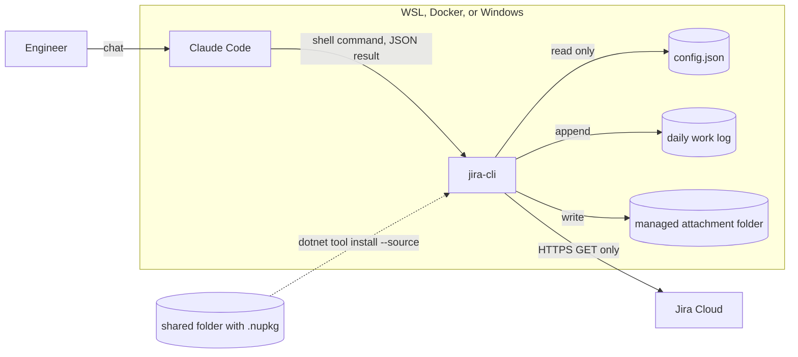
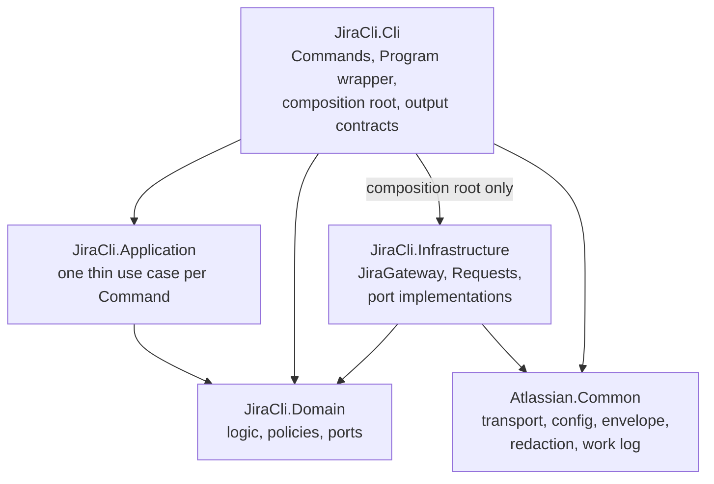
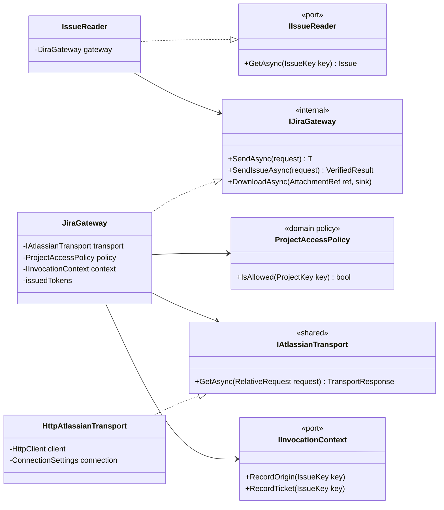
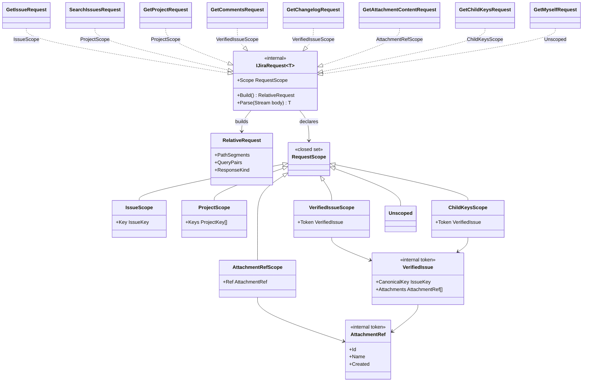
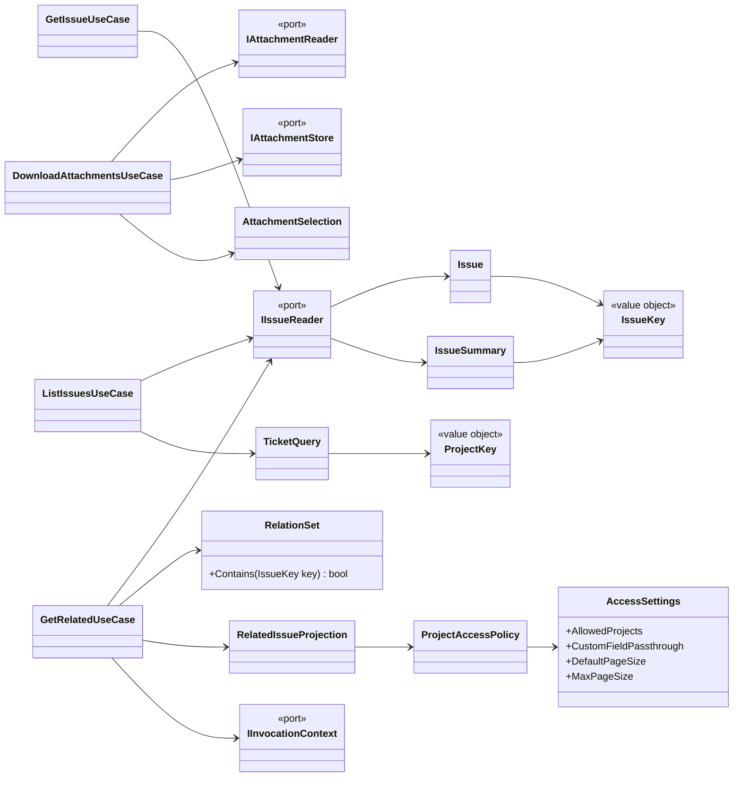
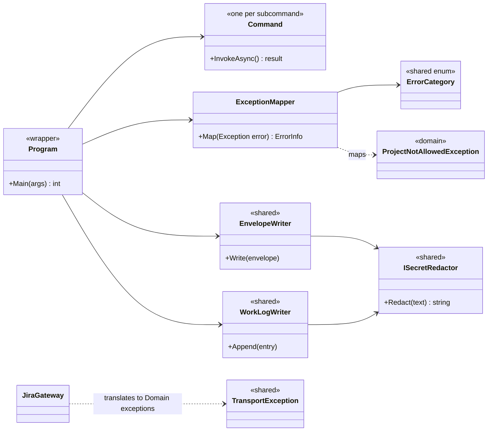
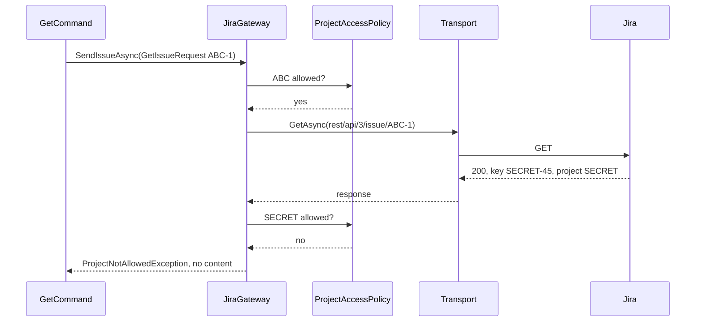
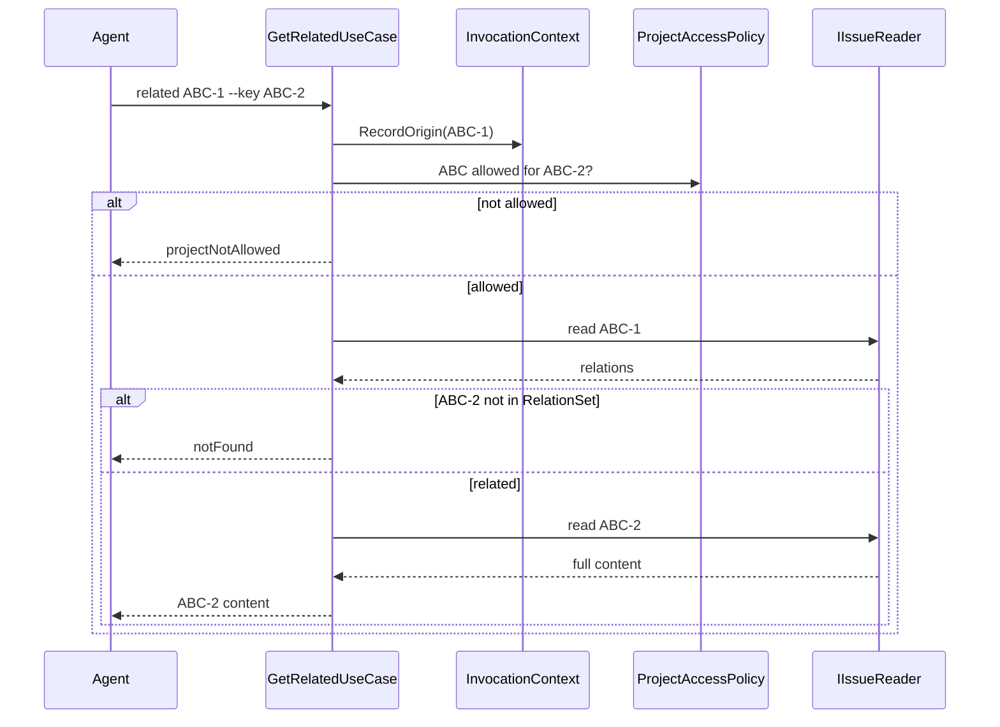

# jira-cli Architecture Explainer

jira-cli is a read-only Jira Cloud command-line tool that Claude Code calls from its shell. This document walks through its structure so the department can review it before implementation starts.

The binding rules are in the architecture spine, [ARCHITECTURE-SPINE.md](ARCHITECTURE-SPINE.md), and `AD-n` below refers to its decisions. Requirements are in the [PRD](../../prds/prd-jira-cli-2026-11-01/prd.md).

## Decisions to review

| Decision | Choice | Main cost |
| --- | --- | --- |
| Structure | Hexagonal architecture on our Clean Architecture project split | Five projects for a small CLI |
| Safety | One protection proxy for all Jira calls, with a GET-only transport | Every endpoint needs a Request class and a declared scope |
| List scope | `--project` is required; free-form JQL is not accepted | The agent must name projects in every `list` command |
| Output | One JSON document on stdout, with fixed exit codes | No human-readable format |
| Attachments | Saved only to a tool-managed folder, replacing existing files | The agent copies files if a repository needs them |
| Distribution | Framework-dependent .NET tool from a shared folder | Every environment needs the .NET 10 SDK |

## Questions for reviewers

1. Does the five-project split match how we expect this tool to be maintained?
2. Is the threat boundary acceptable, given that the agent can read the API token?
3. Can every environment accept the .NET 10 SDK requirement?
4. Is there a shared location for the `.nupkg` that agent environments cannot write to?

## System context

Jira's API calls every work item an issue, so `Issue` in the code means any type: epic, story, bug, task, subtask, or a custom type. jira-cli reads them all.

jira-cli is stateless and has no server component. It covers only the Jira read steps of the request-to-PR loop: listing tickets; reading a ticket with its related tickets, attachments, and history; and re-reading the ticket after merge. Any change to Jira stays manual.

## Project structure

- `Domain` and `Atlassian.Common` reference no other project in the solution.
- `Atlassian.Common` contains nothing specific to Jira, so a future Confluence client can reuse it.
- Architecture tests enforce these directions (AD-1, AD-2, AD-20).

## Class architecture

These diagrams cover how code reaches Jira, how endpoints declare access, where the logic lives, and how results reach the agent. They use the type names that the spine defines. Members are illustrative where the spine leaves them to implementation.

### Reaching Jira: the protection proxy

Adapters can reach Jira only through `JiraGateway`, and only `JiraGateway` can reach the transport. The transport has no method other than `GetAsync`, and `RelativeRequest` has no HTTP method field, so a write cannot be expressed in code that compiles (AD-4, AD-5).

### Requests and scopes

Each Jira endpoint is one Request class. `Build()` and `Parse()` can be unit-tested without HTTP. Each Request also declares a scope, which the Gateway enforces (AD-6, AD-7). New `RequestScope` kinds and `Unscoped` entries require a change to AD-7, and a test compares every Request against a reviewed Request-to-scope table.

| Scope | Before the call | After the call |
| --- | --- | --- |
| `IssueScope` | Key's project is allowed | Returned issue's project is allowed |
| `ProjectScope` | Non-empty, and every project is allowed | Every returned item's project is allowed |
| `VerifiedIssueScope` | Verification token was issued by this Gateway | None |
| `AttachmentRefScope` | The ref was minted by this Gateway | None |
| `ChildKeysScope` | Type is exactly `GetChildKeysRequest`, and the verification token was issued by this Gateway | Every item has a project; the allow-list is not applied |
| `Unscoped` | Type is exactly `GetMyselfRequest` | None |

The check after the call (the post-check) fails closed: a returned item with a missing project is refused. Comment and changelog responses carry no project, so those endpoints require a `VerifiedIssue`, which only a post-checked ticket response produces (AD-8).

### Domain and use cases

Ports use Domain types only. Verification tokens, Requests, and DTOs stay inside `Infrastructure`. Use cases only orchestrate: the relation, projection, and access decisions they call live in `Domain`.

### Output and errors

Commands return data and never write output. The `Program` wrapper writes one JSON envelope to stdout and one work log line for each invocation (AD-13, AD-14, AD-18).

| Exit | Category | Typical cause |
| --- | --- | --- |
| 0 | none | Success |
| 1 | `unexpected` | HTTP 3xx, or another unexpected status or failure |
| 2 | `usage` | Bad arguments, HTTP 400 |
| 3 | `config` | Config missing or invalid |
| 4 | `authentication` | HTTP 401 or 403 |
| 5 | `projectNotAllowed` | Outside the allowed projects, or no project given |
| 6 | `notFound` | HTTP 404, or ticket not related to the origin |
| 7 | `network` | Connection failure, or HTTP 5xx |
| 8 | `timeout` | Request timed out |
| 9 | `rateLimited` | HTTP 429 |
| 10 | `localIo` | Local file system failure |

## Runtime flows

These two flows show the checks that a compliant build can't get from types alone. Both diagrams omit some layers for clarity.

### Reading a ticket that was moved to another project

Jira still returns a moved ticket when it's requested by its old key, so a key-prefix check alone would pass. The post-check compares the project in the response against the allowed projects. The diagram omits the use case and adapter between the Command and the Gateway.

### Following a related ticket

Related tickets are the parent, subtasks, linked tickets, and children such as the stories under an epic. Jira records a child's parent on the child, so children need a search. Because the CLI is stateless, it can log the ticket that a traversal started from (the origin) only if the request includes it, so traversal has its own command. The tool checks that the requested ticket is related to the origin. Related tickets outside the allowed projects appear by key only (AD-10).

### Children in other projects

This search is the one deliberate exception to the rule that every search is limited to allowed projects. It is fixed to `parent = <verified ticket>`, requests only the `project` field, and keeps only ticket and project keys. It can't issue a verification token, so a disallowed child's content stays unreachable. A disallowed child appears by key only, and a notice tells the agent to ask the engineer to add the project. The command still succeeds, with exit code 0. Other allowed children remain readable.

## What the safety guarantee covers

No argument, config path trick, or Jira response can make jira-cli write to Jira or read outside the allowed projects. Automated tests cover this guarantee (AD-3, AD-20).

| Threat | Countermeasure |
| --- | --- |
| Write to Jira | The transport can only send GET |
| JQL injection | Typed filters only, with one escaping builder |
| Moved ticket | Post-check on the response's project |
| Other-project data embedded in a ticket | Relations reduced to keys; custom fields rendered by schema type, and other types omitted; history values shown only for known fields |
| Config redirected by `HOME` or `USERPROFILE` | Path resolved from the OS user record and process token, with no fallback |
| API token printed through `@file` arguments | `@file` expansion turned off in the argument parser |
| Attachment written to a sensitive location | No target option; saved only under the managed folder, refusing links in its path |
| API token sent to another host | Sent only to the base URL, and redirects are not followed |

### Outside the guarantee

- An agent can read the API token and call Jira directly. The PRD accepts this and relies on an API token with read-only scopes to limit the impact.
- A child in a project the token's account can't see produces no notice, because Jira doesn't return it.
- jira-cli trusts the OS user record for its config path, so containers must run the agent as non-root with `/etc/passwd` not writable by it.
- jira-cli does not stop an agent from editing its config file. The engineer must protect the file and its parent directories, as the README describes.
- Tampering with the process's runtime environment, editing the Windows registry, and a process under the same account changing the attachment folder during a download are out of scope. Proxy settings follow .NET defaults, so pointing the tool at a different proxy is also out of scope.
- A field the engineer lists in `customFieldPassthrough` is output as raw JSON, including any other-project data it contains.

## Not yet proven

- **Jira behavior:** nothing has run against a real Jira site. Assumptions about API behavior come from Atlassian's published OpenAPI specification. The first Gateway and attachment stories run live checks of `redirect=false`, attachment access with a scoped API token, comment paging, and the `statusCategory` filter, and the child search.
- **Corporate network:** the department uses a proxy, but its effect on the route to Jira is unknown. TLS inspection may require root certificates in WSL and Docker.
- **Platforms:** package install and run were tested on win-arm64 and linux-arm64 glibc. Neither x64 nor Alpine (musl) has been tested.

## Adding a feature

A new read command touches these places:

1. **Request:** add a `…Request` with tests for `Build` and `Parse`, then declare its scope and add it to the Request-to-scope table.
2. **Port and adapter:** extend or add a port in `Domain`, and implement it in `Infrastructure` through `IJiraGateway`.
3. **Use case:** add one thin use case in `Application`, with any logic in `Domain`.
4. **Command and contract:** add the `…Command`, its output type in `JiraCli.Cli/Contracts`, and a golden output test.
5. **Usage guide:** update the Claude Code usage guide if the agent's workflow changes.

The Gateway's checks, the envelope, redaction, and the work log apply without further work.

## Stack

jira-cli targets .NET 10 (LTS) and Jira Cloud REST API v3, and uses System.CommandLine, Microsoft.Extensions.DependencyInjection, xunit.v3, and NetArchTest.eNhancedEdition. The spine pins the exact versions.
